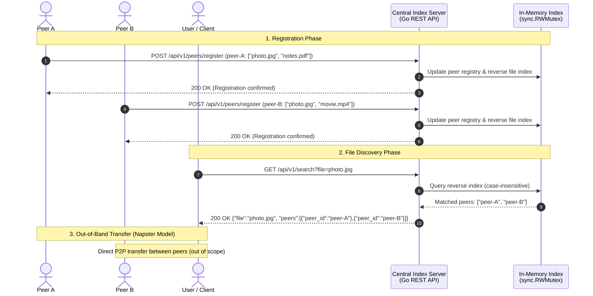

# Distributed File Index (Napster-Inspired Architecture)

---

### Academic Information
- **Group Number:** `9`
- **Project Title:** `Simple Distributed File Index`
- **Course:** Distributed Systems
- **Team Members & Roll Numbers:**
  - `Kshitij Jain` - `241000041`
  - `Kuldeep Patidar` - `241000042`
  - `Kushagra Kumar Singh` - `241000044`
  - `Lakshya Dewangan` - `241000045`

---

## 1. Overview
The **Distributed File Index** is a lightweight, reliable, and clean implementation of a centralized file-indexing system inspired by first-generation peer-to-peer (P2P) file sharing networks such as **Napster**. 

In this system, a central server maintains a directory of file locations across distributed peers. Clients register their locally available files with the central coordinator, and users query the central directory to discover which peers host a specific file.

---

## 2. Problem Statement
First-generation peer-to-peer architectures solved the file discovery problem using a hybrid model:
- Finding files in a purely decentralized network without structured indexing is inefficient and flood-heavy.
- Transferring large files through a single central server bottlenecks bandwidth and server resources.

Napster solved this by decoupling **file discovery** (centralized index) from **file transfer** (direct peer-to-peer). This project implements and demonstrates the centralized file indexing and discovery core of this architecture.

---

## 3. Objectives
- Implement a centralized REST API server in Go that manages peer IDs and filename associations.
- Provide dynamic peer registration with automatic reverse-index updates when a peer's file list changes.
- Implement case-insensitive, deterministic file search across registered peers.
- Guarantee concurrency safety using Go's `sync.RWMutex`.
- Provide a clean, minimal, responsive web dashboard with live statistics.
- Provide a terminal-friendly Go CLI client for command-line demonstration.

---

## 4. Architecture Explanation
The central server maintains the file index in memory and serves as the single source of truth for file discovery.
Peers register their available filenames with the central server upon joining or updating their shared list.
Users can search for files through the central index to discover which peers host the requested file.
The system implements file discovery only; actual file transfer between peers is handled out-of-band and is not implemented.
The index is stored in memory using Go maps and resets when the server restarts.

---

## 5. Architecture Diagram



---

## 6. Technologies Used
- **Backend:** Go (Go 1.22+ standard library: `net/http`, `sync.RWMutex`, `encoding/json`, `sort`, `strings`)
- **Frontend:** HTML5, CSS3, Vanilla JavaScript (no external frameworks, libraries, or CDNs)
- **Data Storage:** In-memory Go maps protected by read-write mutex locks (`sync.RWMutex`)
- **Communication:** RESTful JSON APIs over HTTP

---

## 7. Prerequisites and Dependencies
- **Operating System:** Ubuntu Linux (or any modern Linux / macOS / Windows system)
- **Go Compiler:** Go 1.22 or higher (`go version`)
- **Web Browser:** Any modern browser (Firefox, Chrome, Edge)
- **Networking Tools (Optional):** `curl` for manual API verification
- **Zero External Dependencies:** No Node.js, npm, databases, or external internet connections required.

---

## 8. Exact Commands to Run on Ubuntu

### Step 1: Verify Go Installation
```bash
go version
```

### Step 2: Navigate to Project Directory
```bash
cd /path/to/distributed-file-index
```

### Step 3: Run the Central Server
```bash
go run ./cmd/server
```
*The server will start listening on `http://localhost:8080` and serve both the REST API and the web dashboard.*

Optional port configuration:
```bash
go run ./cmd/server --port 8080 --web-dir web
```

---

## 9. How to Access the Dashboard
1. Ensure the server is running.
2. Open your web browser and navigate to:
   ```
   http://localhost:8080
   ```
3. The dashboard provides:
   - **Live Health Status:** Server online/offline indicator.
   - **Overview Statistics:** Real-time counts of Total Registered Peers, Total Unique Files, and Total File Registrations.
   - **Peer Registration Form:** Register a new peer ID and comma-separated filenames.
   - **File Search Section:** Perform case-insensitive searches and view matching peers.
   - **Registered Peers Directory:** View all peers, their file counts, and filename badges, with a manual refresh action.

---

## 10. How to Register Peers Using the CLI
Open a new terminal window while the server is running:

```bash
# Register peer-A
go run ./cmd/peer register --server http://localhost:8080 --id peer-A --files "notes.pdf,photo.jpg,report.txt"

# Register peer-B
go run ./cmd/peer register --server http://localhost:8080 --id peer-B --files "photo.jpg,movie.mp4"

# Register peer-C
go run ./cmd/peer register --server http://localhost:8080 --id peer-C --files "assignment.cpp,notes.pdf"
```

Re-registering a peer replaces its previous file list and updates the reverse index:
```bash
# Update peer-A to share only notes.pdf
go run ./cmd/peer register --server http://localhost:8080 --id peer-A --files "notes.pdf"
```

---

## 11. How to Search Using the CLI

```bash
# Search for a file hosted by multiple peers
go run ./cmd/peer search --server http://localhost:8080 --file photo.jpg

# Search is case-insensitive
go run ./cmd/peer search --server http://localhost:8080 --file PHOTO.JPG

# Search for a nonexistent file
go run ./cmd/peer search --server http://localhost:8080 --file unknown.iso

# List all registered peers and their files
go run ./cmd/peer list --server http://localhost:8080
```

---

## 12. Example API Requests and Responses

### A. Health Check
- **Request:** `GET /health`
- **Response:**
  ```json
  {
    "status": "ok"
  }
  ```

### B. Register a Peer
- **Request:** `POST /api/v1/peers/register`
- **Headers:** `Content-Type: application/json`
- **Body:**
  ```json
  {
    "peer_id": "peer-A",
    "files": ["notes.pdf", "photo.jpg", "report.txt"]
  }
  ```
- **Response (HTTP 200 OK):**
  ```json
  {
    "status": "success",
    "message": "Peer registered successfully",
    "peer_id": "peer-A",
    "files": ["notes.pdf", "photo.jpg", "report.txt"]
  }
  ```

### C. Search for a File
- **Request:** `GET /api/v1/search?file=photo.jpg`
- **Response (File Found - HTTP 200 OK):**
  ```json
  {
    "file": "photo.jpg",
    "peers": [
      {
        "peer_id": "peer-A"
      },
      {
        "peer_id": "peer-B"
      }
    ]
  }
  ```
- **Response (File Not Found - HTTP 200 OK):**
  ```json
  {
    "file": "missing.iso",
    "peers": []
  }
  ```

### D. List Registered Peers
- **Request:** `GET /api/v1/peers`
- **Response (HTTP 200 OK):**
  ```json
  {
    "peers": [
      {
        "peer_id": "peer-A",
        "files": ["notes.pdf", "photo.jpg", "report.txt"]
      },
      {
        "peer_id": "peer-B",
        "files": ["movie.mp4", "photo.jpg"]
      }
    ]
  }
  ```

### E. Index Statistics
- **Request:** `GET /api/v1/stats`
- **Response (HTTP 200 OK):**
  ```json
  {
    "total_peers": 2,
    "total_unique_files": 4,
    "total_registrations": 5
  }
  ```

---

## 13. Testing Instructions

### Run All Unit and Race Detection Tests
```bash
go test -v -race ./...
```

### Run Go Vet (Static Analysis)
```bash
go vet ./...
```

### Verify Code Formatting
```bash
gofmt -d .
```

### Test Coverage Highlights
The test suite in `internal/index/index_test.go` and `internal/api/handlers_test.go` covers:
1. **Peer Registration:** Verification of peer insertion and file assignment.
2. **Existing File Search:** Locating peers hosting a specific file.
3. **Nonexistent File Search:** Ensuring empty slice `[]` (not `null`) response when file is missing.
4. **Multiple Peers with Identical Files:** Verifying reverse index aggregation and deterministic sorting.
5. **Updating Existing Registrations:** Verifying old reverse-index references are cleaned up.
6. **Filename Deduplication:** Case-insensitive deduplication and whitespace trimming on registration.
7. **Case-Insensitive Search:** Querying with mixed cases (`Photo.JPG`, `photo.jpg`, `PHOTO.JPG`).
8. **Concurrent Access:** Goroutines executing simultaneous reads and writes under race detector.
9. **Listing Peers:** Deterministic sorting of peers and files.
10. **Input Validation:** Proper HTTP 400 rejection of empty peer IDs and filenames.

---

## 14. Limitations
- **Discovery Only:** In alignment with the project scope, only directory indexing and discovery are implemented; direct peer-to-peer file transfer is not performed.
- **Volatile Storage:** The index is kept purely in memory; restarting the server clears all registered peer data.
- **Single Central Node:** Modeled after early Napster, the central coordinator represents a single point of failure and centralization tradeoff.
- **No Peer Heartbeat/Keepalive:** Peers remain registered until explicitly updated with a new file list or until the server restarts.
